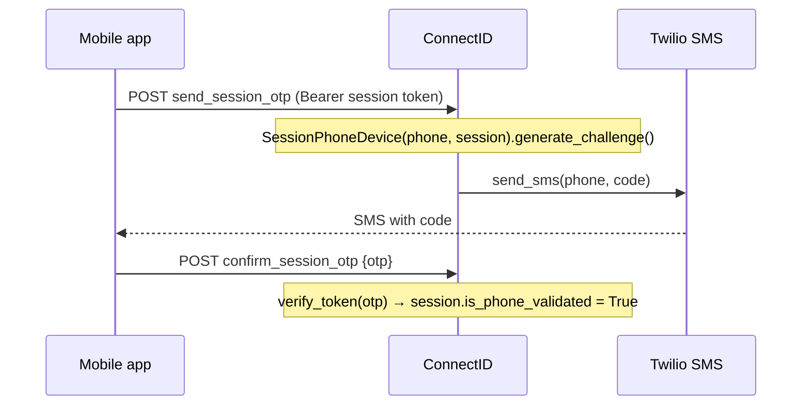
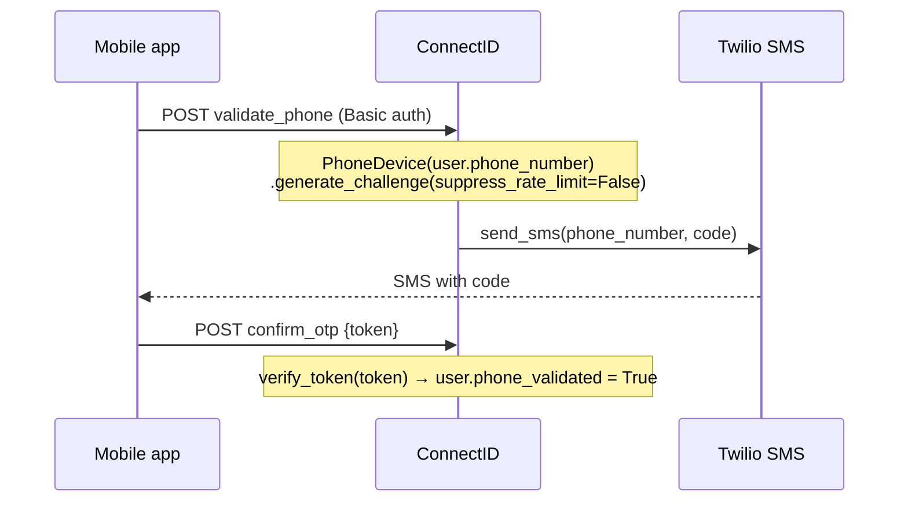
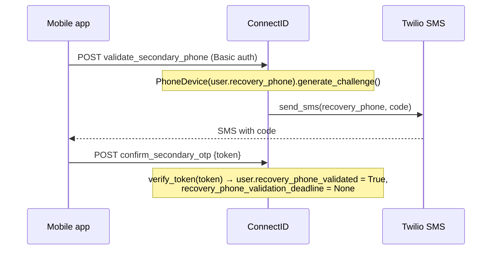
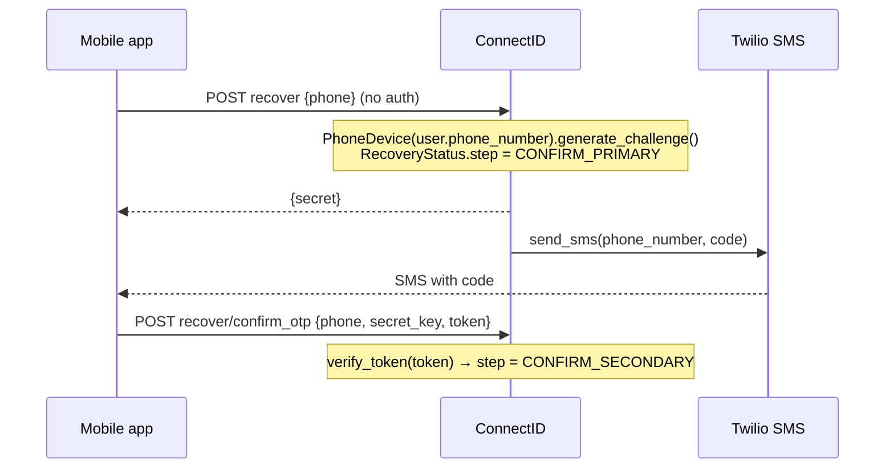
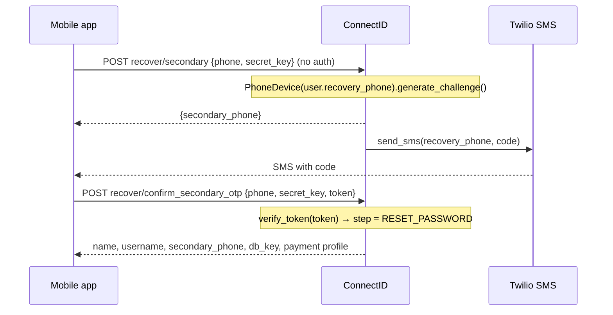
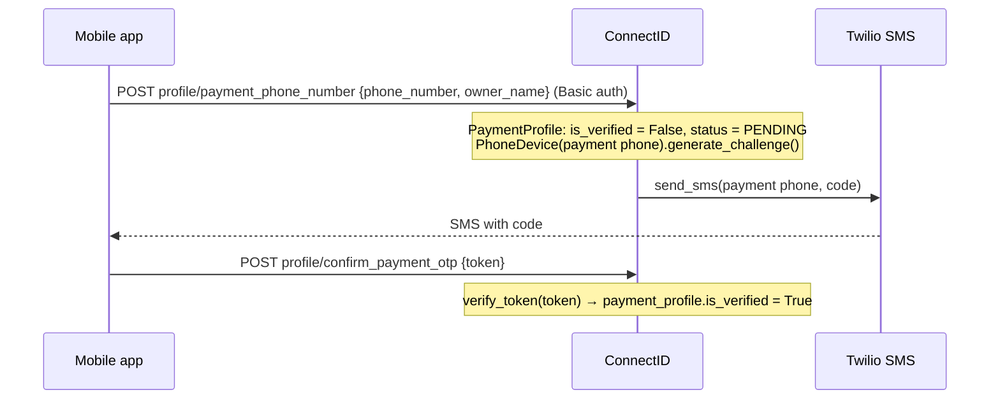
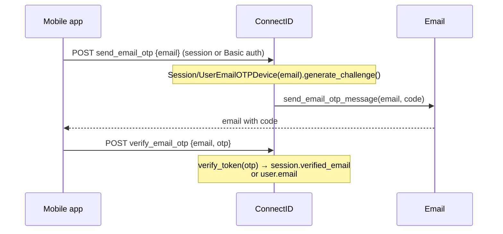
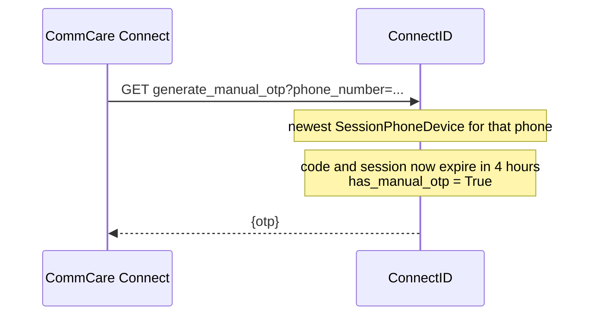

# One-Time Code (OTP) Flows

This page lists every place ConnectID sends a one-time code to a user, where the mobile app sends the code back, and what a correct code changes.

There are two ways a phone number gets verified:

- **Firebase Phone Auth**: Google sends and checks the code inside the app. ConnectID only checks the resulting Firebase ID token. This is the default.
- **ConnectID ("PersonalID") SMS**: ConnectID generates the code, stores it on an OTP device row, and sends it through the SMS vendor (Twilio). The app uses this as a fallback.

Email addresses are always verified with a ConnectID code.

## Summary

| Flow | Who calls it | Send endpoint | Device model | Confirm endpoint | A correct code sets |
|------|--------------|---------------|--------------|------------------|---------------------|
| [Firebase](#1-firebase-phone-auth) | Setup session or logged-in user | none (Google sends it) | none | `validate_firebase_id_token` | `session.is_phone_validated` (session only) |
| [Session SMS](#2-session-sms-device-setup) | Setup session | `send_session_otp` | `SessionPhoneDevice` | `confirm_session_otp` | `session.is_phone_validated` |
| [Primary phone](#3-primary-phone-logged-in) | Logged-in user | `validate_phone` | `PhoneDevice` | `confirm_otp` | `user.phone_validated` |
| [Recovery phone](#4-recovery-phone-logged-in) | Logged-in user | `validate_secondary_phone` | `PhoneDevice` | `confirm_secondary_otp` | `user.recovery_phone_validated` |
| [Recovery, step 1](#5-account-recovery-step-1-primary-phone) | No auth | `recover` | `PhoneDevice` | `recover/confirm_otp` | `RecoveryStatus.step = CONFIRM_SECONDARY` |
| [Recovery, step 2](#6-account-recovery-step-2-recovery-phone) | No auth | `recover/secondary` | `PhoneDevice` | `recover/confirm_secondary_otp` | `RecoveryStatus.step = RESET_PASSWORD` |
| [Payment phone](#7-payment-phone) | Logged-in user | `profile/payment_phone_number` | `PhoneDevice` | `profile/confirm_payment_otp` | `payment_profile.is_verified` |
| [Email](#8-email) | Setup session or logged-in user | `send_email_otp` | `SessionEmailOTPDevice` / `UserEmailOTPDevice` | `verify_email_otp` | `session.verified_email` or `user.email` |
| [Support lookup](#support-lookup-from-commcare-connect) | CommCare Connect (server) | nothing is sent | `SessionPhoneDevice` | same as Session SMS | — |

All endpoints are under `/users/` (see `users/urls.py`). Views are in `users/views.py`, except the payment phone views, which are in `payments/views.py`.

## How callers authenticate

- **Setup session**: `start_device_configuration` creates a `ConfigurationSession` and returns its `key` as `token`. The app sends it as `Authorization: Bearer <token>`, checked by `SessionTokenAuthentication` (`users/auth.py`). A session expires after 4 hours. `request.user` is a placeholder `SessionUser`; the session is on `request.auth`.
- **Logged-in user**: at the end of setup, `complete_profile` (new account) or `complete_recovery` (existing account) returns a random `username` and `password`. The app sends these as HTTP Basic auth on every later request, checked by `DeviceBasicAuthentication`. These are the DRF defaults in `connectid/settings.py`, so any view without its own `authentication_classes` expects them.
- **No auth**: the recovery views use `@permission_classes([])`. Later recovery calls prove they belong to the same attempt with the `secret_key` returned by `recover` and the stored `RecoveryStatus.step`.

## Shared code behaviour

Every ConnectID code goes through `BaseOTPDevice` in `users/models.py`, which builds on `django_otp`'s `SideChannelDevice`.

**Sending** (`generate_challenge()` → `_attempt_send()`):

1. Locks the device row.
2. Makes a new code only if there is none or the current one expires within 5 minutes. Otherwise it re-sends the same code.
3. Applies a resend cooldown of 2<sup>attempts</sup> minutes (2, 4, 8, …). If the cooldown has not passed it raises `RateLimitedError`.
4. Sends the code. Phone devices call `send_sms()` (`sms/__init__.py`), which picks a vendor from `SMS_VENDORS` (`sms/registry.py`): Twilio in production, console output locally. Email devices call `send_email_otp_message()` (`users/email_utils.py`).

SMS codes are valid for 30 minutes. Email codes are valid for `EMAIL_OTP_VALIDITY_SECONDS` (default 1800).

`PhoneDevice.generate_challenge()` ignores `RateLimitedError` unless called with `suppress_rate_limit=False`. Only `validate_phone` does that. In flows 4–7 a rate-limited request therefore returns 200 and sends nothing.

**Verifying** (`verify_token()`):

1. Locks the device row so concurrent wrong guesses each count.
2. Fails immediately once `MAX_OTP_VERIFY_ATTEMPTS` (3) wrong guesses have been made.
3. A correct code resets the counters. The wrong guess that uses the last attempt burns the code: it is cleared and expires immediately, so a new code must be requested.
4. Email devices also add an hour-based cooldown after a burn: 1, 2, then at most 4 hours (`MAX_OTP_BURN_COOLDOWN_HOURS`).

## Which method the app uses

`start_device_configuration` tells the app how to send the setup code:

- API v2: `sms_method: "firebase"` and `otp_fallback: true`.
- API v1: `sms_method: "personal_id"` for invited users, otherwise `"firebase"`, with no fallback.

In the Android app (`BasePersonalIdPhoneVerificationFragment.kt` in `dimagi/commcare-android`), the phone verification screen starts with that method. When fallback is allowed it switches to ConnectID SMS after a non-recoverable Firebase error or on the first resend. Signup allows fallback when `otp_fallback` is true; Manage Profile always starts with Firebase and always allows fallback. `ApiPersonalId.sendPhoneOtp()` calls `validate_phone` when it has Basic auth and `send_session_otp` when it has a session token.

## Flows

### 1. Firebase phone auth

Default for device setup and for Manage Profile. ConnectID never sees the code.

```mermaid
sequenceDiagram
    participant App as Mobile app
    participant CID as ConnectID
    participant FB as Firebase (Google)
    App->>CID: POST start_device_configuration {phone_number}
    CID-->>App: token, sms_method: firebase, otp_fallback
    App->>FB: request code (Firebase SDK)
    FB-->>App: SMS with code
    App->>FB: submit code
    FB-->>App: Firebase ID token
    App->>CID: POST validate_firebase_id_token {token}
    Note over CID: verify_id_token(); phone in token must match<br/>session phone (or user.phone_number)
    Note over CID: session caller: session.is_phone_validated = True
```

- Accepts a session token or Basic auth. For a logged-in user it only checks the phone number and changes nothing.
- Errors: 400 `MISSING_TOKEN`, `FAILED_VALIDATING_TOKEN`, `INVALID_TOKEN` or `PHONE_MISMATCH`.

### 2. Session SMS (device setup)

Fallback for device setup. The person has no account login yet, so the code belongs to the `ConfigurationSession`.



- Rate limited: 429 `RATE_LIMITED` with `retry_after_seconds`.
- Wrong code: 401 `INCORRECT_OTP` with `attempts_left`. After the last attempt: 401 `OTP_LIMIT_EXCEEDED` with `retry_after_seconds`.
- Flows 1 and 2 are how a session gets `is_phone_validated`, which `complete_profile`, `check_user_similarity`, `confirm_backup_code`, `complete_recovery`, `send_email_otp` and `verify_email_otp` require. Phone numbers starting with `TEST_NUMBER_PREFIX` (demo users) start out validated.

### 3. Primary phone (logged in)

Used by Manage Profile when the user must verify their phone before changing their email and Firebase is not used.



- Rate limited: 429 `RATE_LIMITED` with `retry_after_seconds`.
- Wrong code: same as Session SMS.

### 4. Recovery phone (logged in)

Confirms the backup phone number later used for account recovery.



- Rate limited: 200, no SMS sent.
- Wrong code: 401 `{"error": "OTP token is incorrect"}`. No recovery phone: 400.

### 5. Account recovery, step 1 (primary phone)

Starts recovery for someone who lost access to their device.



- Rate limited: 200 with a new `secret`, no SMS sent.
- Wrong code: 401 `{"error": "OTP token is incorrect"}`. Wrong secret or step: 401 with no body. Locked account: 401 `LOCKED_ACCOUNT`.

### 6. Account recovery, step 2 (recovery phone)

Second factor for recovery. Only allowed once step 1 has set `CONFIRM_SECONDARY`.



- Rate limited: 200, no SMS sent.
- Wrong code: 401 `{"error": "OTP token is incorrect"}`.

### 7. Payment phone

Confirms the number a user is paid on. Saving the number resets the payment profile to unverified before the code is sent.



- Rate limited: 200, no SMS sent.
- Wrong code: 401 `{"error": "OTP token is incorrect"}`.

### 8. Email

Both endpoints are behind the `EMAIL_OTP_VERIFICATION` waffle switch and return 404 while it is off. The device type follows the caller: a setup session gets a `SessionEmailOTPDevice`, a logged-in user gets a `UserEmailOTPDevice`.



- Session callers get 403 `PHONE_NOT_VALIDATED` until flow 1 or 2 has succeeded.
- Rate limited: 429 `RATE_LIMITED` with `retry_after_seconds`.
- Wrong code: 401 `INCORRECT_OTP` / `OTP_LIMIT_EXCEEDED`.
- During account recovery, until the backup code is verified, `send_email_otp` ignores the submitted address and uses the email on record. `verify_email_otp` returns 403 `NOT_ALLOWED`; the code is checked by `recover/complete_recovery` instead (`_verify_recovery_email_otp`).
- A verified email on a setup session is copied to the new user by `complete_profile`.

## Support lookup from CommCare Connect

For a user whose Session SMS (flow 2) never arrived. Support staff use the "Connect OTPs" page in CommCare Connect (`RetrieveUserOTPView`), which calls `GenerateManualOTP` with Connect's client credentials. Nothing is sent.



- Returns 404 `SESSION_NOT_FOUND` if there is no device or its session has expired. This happens if the app used Firebase and never called `send_session_otp`.
- The user then enters the code in the app, which submits it to `confirm_session_otp`.
- `has_manual_otp` is only used for monitoring.

## Related code

- `users/models.py`: `BaseOTPDevice`, `BasePhoneDevice`, `PhoneDevice`, `SessionPhoneDevice`, `BaseEmailOTPDevice`, `ConfigurationSession`, `RecoveryStatus`
- `users/views.py`: all views above except the payment phone views
- `payments/views.py`: `update_payment_profile_phone`, `confirm_payment_profile_otp`
- `users/auth.py`: `SessionTokenAuthentication`, `DeviceBasicAuthentication`
- `users/const.py`: `MAX_OTP_VERIFY_ATTEMPTS`, `MAX_OTP_BURN_COOLDOWN_HOURS`, `ErrorCodes`
- `sms/`: `send_sms()` and the SMS vendor registry
- `users/email_utils.py`: email delivery
